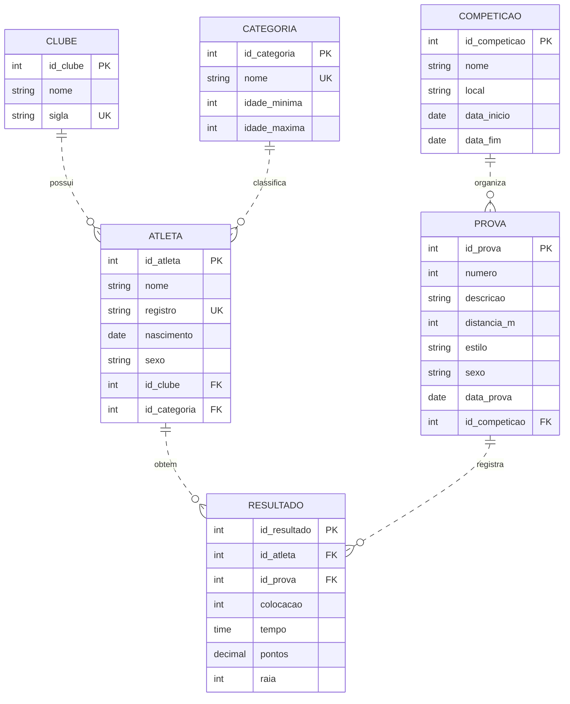

# Modelagem e Estatística — Troféu Alexandre Pussieldi

Projeto acadêmico de modelagem de dados e consultas estatísticas para um campeonato de natação, utilizando Mermaid ER e PostgreSQL.

> **Importante:** o diagrama e os scripts abaixo representam uma proposta lógica. Antes de executar no banco do projeto, confira os nomes reais das tabelas e colunas, as regras de pontuação e a identificação de resultados válidos. Não são apresentados resultados oficiais fictícios.

## Sumário

1. [Modelo Entidade-Relacionamento](#1-modelo-entidade-relacionamento)
2. [Scripts SQL](#2-scripts-sql)
   - [Quadro de medalhas](#21-sp_quatro_de_migalhas)
   - [Desempenho por equipe](#22-sp_atlas_e_cubos)
3. [Como executar](#3-como-executar)
4. [Log documentado do uso da IA](#4-log-documentado-do-uso-da-ia)
5. [Justificativas técnicas](#5-justificativas-técnicas)
6. [Checklist de validação](#6-checklist-de-validação)

---

## 1. Modelo Entidade-Relacionamento

O modelo contém as entidades `CLUBE`, `ATLETA`, `CATEGORIA`, `COMPETICAO`, `PROVA` e `RESULTADO`.



### Entidades e chaves

| Entidade | Finalidade | Chaves principais |
|---|---|---|
| `CLUBE` | Cadastro das equipes | `id_clube` (PK), `sigla` (UK) |
| `ATLETA` | Cadastro dos nadadores | `id_atleta` (PK), `registro` (UK), `id_clube` (FK), `id_categoria` (FK) |
| `CATEGORIA` | Classificação etária | `id_categoria` (PK), `nome` (UK) |
| `COMPETICAO` | Identificação de cada edição | `id_competicao` (PK) |
| `PROVA` | Cadastro das provas | `id_prova` (PK), `id_competicao` (FK) |
| `RESULTADO` | Desempenho do atleta em uma prova | `id_resultado` (PK), `id_atleta` (FK), `id_prova` (FK) |

**Cardinalidades:** um clube pode estar relacionado a vários atletas; uma competição possui várias provas; um atleta e uma prova podem ter vários resultados ao longo da competição. `RESULTADO` resolve o relacionamento muitos-para-muitos entre atletas e provas.

**Relacionamentos não identificadores:** foi usada a linha tracejada (`..`) porque as chaves estrangeiras não compõem as chaves primárias das entidades dependentes.

**Premissas:** cada atleta possui um clube e uma categoria principal neste modelo simplificado. Caso o sistema registre transferência de clube, inscrições por edição ou categorias por competição, recomenda-se modelar essas informações em entidades associativas. O tipo `time` segue a especificação do exercício, mas duração de natação costuma ser representada melhor em milissegundos (`int`) ou segundos (`decimal`).

---

## 2. Scripts SQL

Os scripts usam procedures PostgreSQL com cursor de saída. As tabelas e colunas utilizadas são as do modelo acima e precisam ser comparadas com o esquema real do banco.

### 2.1 `sp_quatro_de_migalhas`

Gera o quadro de medalhas por clube, ordenado por ouro, prata, bronze e nome do clube.

```sql
CREATE OR REPLACE PROCEDURE sp_quatro_de_migalhas(
    IN p_id_competicao INT,
    INOUT p_resultado REFCURSOR
)
LANGUAGE plpgsql
AS $$
BEGIN
    OPEN p_resultado FOR
        SELECT
            c.id_clube,
            c.nome AS clube,
            COUNT(*) FILTER (WHERE r.colocacao = 1) AS ouro,
            COUNT(*) FILTER (WHERE r.colocacao = 2) AS prata,
            COUNT(*) FILTER (WHERE r.colocacao = 3) AS bronze,
            COUNT(*) FILTER (
                WHERE r.colocacao BETWEEN 1 AND 3
            ) AS total_medalhas
        FROM clube c
        JOIN atleta a
            ON a.id_clube = c.id_clube
        JOIN resultado r
            ON r.id_atleta = a.id_atleta
        JOIN prova p
            ON p.id_prova = r.id_prova
        WHERE p.id_competicao = p_id_competicao
        GROUP BY c.id_clube, c.nome
        ORDER BY
            ouro DESC,
            prata DESC,
            bronze DESC,
            c.nome ASC;
END;
$$;
```

**Observações:**
- `COUNT(*) FILTER` contabiliza separadamente cada colocação.
- O total de medalhas considera as posições de 1º a 3º lugar.
- A consulta pressupõe que `RESULTADO` contém apenas resultados elegíveis para medalhas. Se houver status de desclassificação, ausência ou fases que não concedem medalha, adicione o filtro correspondente ao esquema real.
- Clubes sem resultados não aparecem porque a consulta utiliza `JOIN`.

### 2.2 `sp_atlas_e_cubos`

Gera indicadores de desempenho por equipe: atletas, participações, pontos, medalhas e distribuição etária.

```sql
CREATE OR REPLACE PROCEDURE sp_atlas_e_cubos(
    IN p_id_competicao INT,
    INOUT p_resultado REFCURSOR
)
LANGUAGE plpgsql
AS $$
BEGIN
    OPEN p_resultado FOR
        SELECT
            c.id_clube,
            c.nome AS clube,
            COUNT(DISTINCT a.id_atleta) AS total_atletas,
            COUNT(r.id_resultado) AS total_participacoes,
            COALESCE(SUM(r.pontos), 0) AS pontos_totais,
            COUNT(r.id_resultado) FILTER (
                WHERE r.colocacao = 1
            ) AS ouro,
            COUNT(r.id_resultado) FILTER (
                WHERE r.colocacao = 2
            ) AS prata,
            COUNT(r.id_resultado) FILTER (
                WHERE r.colocacao = 3
            ) AS bronze,
            COUNT(DISTINCT a.id_atleta) FILTER (
                WHERE EXTRACT(
                    YEAR FROM age(cp.data_inicio, a.nascimento)
                ) BETWEEN 0 AND 9
            ) AS atletas_pre_mirim,
            COUNT(DISTINCT a.id_atleta) FILTER (
                WHERE EXTRACT(
                    YEAR FROM age(cp.data_inicio, a.nascimento)
                ) BETWEEN 10 AND 11
            ) AS atletas_mirim,
            COUNT(DISTINCT a.id_atleta) FILTER (
                WHERE EXTRACT(
                    YEAR FROM age(cp.data_inicio, a.nascimento)
                ) >= 12
            ) AS atletas_outras_categorias
        FROM clube c
        JOIN atleta a
            ON a.id_clube = c.id_clube
        JOIN resultado r
            ON r.id_atleta = a.id_atleta
        JOIN prova p
            ON p.id_prova = r.id_prova
        JOIN competicao cp
            ON cp.id_competicao = p.id_competicao
        WHERE cp.id_competicao = p_id_competicao
        GROUP BY c.id_clube, c.nome
        ORDER BY
            pontos_totais DESC,
            total_atletas DESC,
            c.nome ASC;
END;
$$;
```

**Regras etárias consideradas no exercício:**
- **Pré-Mirim:** até 9 anos completos.
- **Mirim:** de 10 a 11 anos completos.
- **Outras categorias:** 12 anos completos ou mais.

A idade é calculada na data de início da competição, como premissa deste exemplo. É necessário confirmar se essa é a data de referência estabelecida pelo regulamento. Os atletas são contados apenas entre aqueles que possuem resultados na competição; para contar todos os inscritos, inclusive quem não teve resultado, o modelo precisará incluir a tabela de inscrições.

---

## 3. Como executar

Substitua `1` pelo identificador real da competição. O cursor deve ser consumido na mesma transação em que foi aberto.

### Quadro de medalhas

```sql
BEGIN;
CALL sp_quatro_de_migalhas(1, 'cur_medalhas');
FETCH ALL FROM cur_medalhas;
COMMIT;
```

### Desempenho por equipe

```sql
BEGIN;
CALL sp_atlas_e_cubos(1, 'cur_equipes');
FETCH ALL FROM cur_equipes;
COMMIT;
```

As tabelas exibidas pelo `FETCH ALL` são os resultados a capturar no pgAdmin ou no cliente SQL utilizado. Não inserir números ilustrativos como se fossem resultados oficiais: as capturas devem vir de uma execução real.

---

## 4. Log documentado do uso da IA

> Este é um registro organizado das etapas de prompting e revisão usadas para desenvolver a solução. Não deve ser interpretado como transcrição literal de mensagens que não estejam preservadas no histórico.

### Interação 1 — Pedido inicial

**Prompt**

> Crie duas procedures em PostgreSQL para um campeonato de natação. A primeira deve gerar um quadro de medalhas por clube, e a segunda deve gerar estatísticas de desempenho das equipes. Inclua comentários e explique as consultas.

**Resposta inicial — síntese**

A IA propôs agrupar resultados por clube, contar colocações em primeiro, segundo e terceiro lugares e somar a pontuação dos atletas.

**Crítica**

A proposta não definia o esquema real das tabelas, o filtro por edição, a regra de pontuação nem o tratamento de resultados inválidos.

### Interação 2 — Correção das categorias etárias

**Prompt**

> Revise a segunda procedure e respeite as regras fornecidas no enunciado: Pré-Mirim até 9 anos e Mirim de 10 a 11 anos. Calcule a idade completa na data de referência da competição e não invente faixas etárias diferentes.

**Resposta corrigida — síntese**

A classificação deve calcular a idade na data de referência e aplicar os limites informados. As idades restantes podem ser agrupadas separadamente para fins estatísticos.

**Crítica**

A IA pode alucinar limites etários ou utilizar a data atual. A regra do enunciado deve prevalecer, e a data de referência precisa ser confirmada no regulamento.

### Interação 3 — Refinamento do SQL

**Prompt**

> Refatore as procedures para PostgreSQL. Utilize parâmetros para selecionar a competição, diferencie medalhas de pontos, conte cada atleta uma única vez no relatório de equipes e adicione comentários. Não invente resultados oficiais e explique as premissas sobre as tabelas.

**Resposta final — síntese**

Foram propostas duas procedures com parâmetro de competição e cursor de saída. A primeira conta medalhas por colocação; a segunda reúne atletas, participações, pontos, medalhas e faixas etárias.

**Crítica**

A estrutura proposta ainda precisa ser comparada ao banco real. O uso de parâmetros evita misturar edições, e `COUNT(DISTINCT ...)` evita contar várias vezes um atleta no indicador de total de atletas.

### Interação 4 — Validação

**Prompt**

> Revise a sintaxe PostgreSQL, explique como executar as procedures e indique o que deve ser conferido antes de apresentar capturas dos resultados.

**Conclusão**

A execução deve ocorrer em uma transação, com consumo do cursor por `FETCH ALL`. É necessário conferir as tabelas, as colunas, a regra de pontuação, os status dos resultados e a data de referência etária.

### Erros e riscos identificados

| Risco | Tratamento |
|---|---|
| Limites etários inventados | Aplicar até 9 anos para Pré-Mirim e 10–11 para Mirim |
| Mistura de edições | Filtrar por `p_id_competicao` |
| Contagem duplicada de atletas | Usar `COUNT(DISTINCT a.id_atleta)` |
| Confusão entre pontos e medalhas | Calcular as métricas separadamente |
| Nomes de tabela presumidos | Documentar as premissas e exigir conferência do esquema |
| Resultados fictícios apresentados como reais | Exigir execução e capturas verdadeiras |

---

## 5. Justificativas técnicas

### 5.1. Normalização e entidades

Separar `ATLETA`, `CLUBE`, `CATEGORIA`, `COMPETICAO`, `PROVA` e `RESULTADO` reduz redundância e melhora a integridade dos dados. `RESULTADO` funciona como entidade associativa entre atletas e provas, armazenando colocação, tempo e pontuação.

### 5.2. Chaves primárias e estrangeiras

As PKs identificam os registros. As FKs garantem referências entre entidades. As Uks representam valores que devem ser únicos, como registro do atleta e sigla do clube, desde que o sistema real confirme essas regras.

### 5.3. Quadro de medalhas

A primeira procedure usa agregações condicionais `COUNT(*) FILTER` e agrupa os resultados por clube. A ordenação por ouro, prata e bronze permite comparar as equipes nessa sequência. A lógica pressupõe que as colocações armazenadas correspondem aos resultados que efetivamente concedem medalhas.

### 5.4. Estatísticas por equipe

A segunda procedure combina:
- `COUNT(DISTINCT ...)` para contar atletas sem duplicação;
- `COUNT(...)` para contar participações;
- `SUM(...)` para acumular pontos;
- `FILTER` para separar medalhas;
- `age()` e `EXTRACT()` para calcular anos completos na data de referência.

As faixas etárias foram mantidas separadas, sem alterar os limites fornecidos no enunciado.

### 5.5. Cursores no PostgreSQL

As procedures abrem um `REFCURSOR` e o cliente consome as linhas com `FETCH ALL` na mesma transação. Uma alternativa seria uma função com `RETURNS TABLE`, que pode ser mais conveniente quando o resultado precisa ser usado diretamente em um `SELECT`.

### 5.6. Limitações

A implementação ainda depende de validação do esquema real, do tratamento de resultados inválidos, dos critérios oficiais de medalha e pontuação e da data oficial de referência etária. A contagem de equipes sem resultados também exigiria `LEFT JOIN` e ajustes nas agregações.

---

## 6. Checklist de validação

- [ ] Conferir os nomes das tabelas e colunas no banco real.
- [ ] Confirmar o ID da competição.
- [ ] Confirmar a data de referência da idade.
- [ ] Confirmar a regra oficial de pontuação e concessão de medalhas.
- [ ] Filtrar desclassificações e resultados inválidos, se aplicável.
- [ ] Executar as duas procedures no PostgreSQL.
- [ ] Capturar as telas dos resultados reais.
- [ ] Validar o Mermaid no [Mermaid Live Editor](https://mermaid.live/).

**Conclusão:** o projeto apresenta uma proposta de modelo ER, duas procedures comentadas, um log documentado do processo de prompting e justificativas técnicas. A validação no banco real é necessária antes de afirmar que os scripts estão funcionais para o sistema do campeonato.
