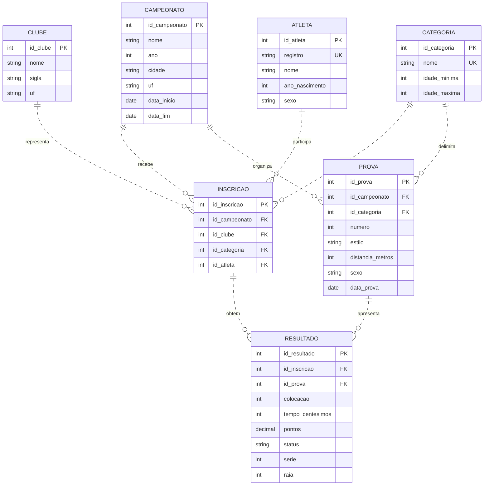

# 29º Troféu Alexandre Pussieldi (2025) — Modelagem e SQL

> **Situação:** proposta técnica **parcialmente validada**. A consulta automatizada a https://faseaquatica.com.br/ retornou HTTP 403; portanto, **não foi possível confirmar os registros e o esquema interno da FASE Aquática**. Não confundir o modelo proposto com a estrutura oficial. Não foram inventados resultados.

## 1. Fontes e evidências

- [FASE Aquática](https://faseaquatica.com.br/) — fonte solicitada, indisponível para consulta automatizada (HTTP 403 em 26/10/2026).
- [Nordestinho — site do evento](https://nordestinho.com.br/) — seção de resultados históricos, incluindo 2025.
- [SESI RN — notícia publicada em 02/04/2025](https://www.rn.sesi.org.br/equipe-de-natacao-sesi-clube-conquista-medalhas-no-trofeu-alexandre-pussieldi/) — confirma edição em Maceió, de 27 a 29/03/2025, e resultados divulgados de atletas do SESI Natal.

**Atenção às categorias:** o enunciado define Pré-Mirim até 9 anos e Mirim de 10 a 11 anos. Há subdivisões Mirim 1 e Mirim 2 em materiais de outras edições, mas **as faixas e regras específicas de 2025 devem ser confirmadas no regulamento/relatórios daquela edição**. O modelo armazena limites configuráveis, sem supor dados oficiais.

## 2. Entidades e decisões

| Entidade | Responsabilidade | Chave |
|---|---|---|
| CAMPEONATO | Edição do evento | `id_campeonato` |
| CLUBE | Equipe participante | `id_clube` |
| CATEGORIA | Faixa etária e subdivisão | `id_categoria` |
| ATLETA | Cadastro do nadador | `id_atleta` |
| INSCRICAO | Vínculo de atleta, clube e campeonato | `id_inscricao` |
| PROVA | Disputa de uma modalidade, categoria e sexo | `id_prova` |
| RESULTADO | Desempenho da inscrição em uma prova | `id_resultado` |

A inscrição separada evita assumir que um atleta permanece no mesmo clube ao longo de diferentes campeonatos. Os resultados são individuais; revezamentos exigiriam entidades adicionais.

## 3. Diagrama Mermaid




### Cardinalidades e normalização

Cada inscrição pertence exatamente a um campeonato, clube, atleta e categoria; cada um deles pode ter zero ou muitas inscrições. Cada prova pertence a um campeonato e categoria e pode ter zero ou muitos resultados. Cada resultado pertence exatamente a uma inscrição e prova. Todas as ligações são **não identificadoras** (`..`) porque as entidades filhas têm PKs independentes. As tabelas separam dados de cadastro, participação e desempenho, reduzindo redundância e aproximando o modelo da 3FN.

## 4. Procedures PostgreSQL

O script SQL completo está incluído diretamente neste README, sem necessidade de arquivo separado.

- `sp_quatro_de_migalhas`: quadro de medalhas por clube, ordenado por ouro, prata e bronze. **Hipótese:** medalhas são atribuídas a colocações 1, 2 e 3 em provas individuais válidas; conferir critérios oficiais de 2025.
- `sp_atlas_e_cubos`: atletas, participações, provas e pontos por equipe. Pontuação depende da tabela oficial; não foi inventada. Não se calcula média geral de tempo entre distâncias e estilos diferentes.

As procedures usam `refcursor` e devem ser chamadas em transação. O script cria **somente a estrutura**, sem atletas ou resultados fictícios. Portanto, relatórios inicialmente vazios são esperados.

### Script SQL completo

```sql
-- PostgreSQL. Modelo proposto, nao extraido da base oficial.
CREATE TABLE campeonato (
 id_campeonato INT GENERATED ALWAYS AS IDENTITY PRIMARY KEY,
 nome VARCHAR(160) NOT NULL, ano INT NOT NULL,
 cidade VARCHAR(100), uf CHAR(2), data_inicio DATE, data_fim DATE
);
CREATE TABLE clube (
 id_clube INT GENERATED ALWAYS AS IDENTITY PRIMARY KEY,
 nome VARCHAR(160) NOT NULL, sigla VARCHAR(40), uf CHAR(2)
);
CREATE TABLE categoria (
 id_categoria INT GENERATED ALWAYS AS IDENTITY PRIMARY KEY,
 nome VARCHAR(60) NOT NULL UNIQUE,
 idade_minima INT NOT NULL CHECK (idade_minima >= 0),
 idade_maxima INT NOT NULL,
 CHECK (idade_maxima >= idade_minima)
);
CREATE TABLE atleta (
 id_atleta INT GENERATED ALWAYS AS IDENTITY PRIMARY KEY,
 registro VARCHAR(40) NOT NULL UNIQUE, nome VARCHAR(160) NOT NULL,
 ano_nascimento INT NOT NULL, sexo CHAR(1) NOT NULL CHECK (sexo IN ('F','M'))
);
CREATE TABLE inscricao (
 id_inscricao INT GENERATED ALWAYS AS IDENTITY PRIMARY KEY,
 id_campeonato INT NOT NULL REFERENCES campeonato,
 id_clube INT NOT NULL REFERENCES clube,
 id_categoria INT NOT NULL REFERENCES categoria,
 id_atleta INT NOT NULL REFERENCES atleta,
 UNIQUE(id_campeonato,id_atleta),
 UNIQUE(id_inscricao,id_campeonato,id_categoria)
);
CREATE TABLE prova (
 id_prova INT GENERATED ALWAYS AS IDENTITY PRIMARY KEY,
 id_campeonato INT NOT NULL REFERENCES campeonato,
 id_categoria INT NOT NULL REFERENCES categoria,
 numero INT NOT NULL, estilo VARCHAR(60) NOT NULL,
 distancia_metros INT NOT NULL CHECK (distancia_metros > 0),
 sexo CHAR(1) NOT NULL CHECK (sexo IN ('F','M')),
 data_prova DATE,
 UNIQUE(id_campeonato,numero),
 UNIQUE(id_prova,id_campeonato,id_categoria)
);
CREATE TABLE resultado (
 id_resultado INT GENERATED ALWAYS AS IDENTITY PRIMARY KEY,
 id_inscricao INT NOT NULL REFERENCES inscricao,
 id_prova INT NOT NULL REFERENCES prova,
 colocacao INT CHECK (colocacao > 0),
 tempo_centesimos INT CHECK (tempo_centesimos >= 0),
 pontos NUMERIC(10,2), status VARCHAR(20) NOT NULL DEFAULT 'VALIDO',
 serie INT, raia INT,
 UNIQUE(id_inscricao,id_prova)
);
-- Consistencia entre campeonato/categoria de inscricao e prova deve
-- ser validada na importacao ou reforcada com trigger/estrutura adicional.

-- Medalhas: hipotese de 1o/2o/3o em provas individuais validas.
CREATE OR REPLACE PROCEDURE sp_quatro_de_migalhas(
 IN p_campeonato INT, INOUT p_cursor REFCURSOR
) LANGUAGE plpgsql AS $$
BEGIN
 OPEN p_cursor FOR
 SELECT c.nome AS clube,
 COUNT(*) FILTER (WHERE r.colocacao=1 AND r.status='VALIDO') AS ouro,
 COUNT(*) FILTER (WHERE r.colocacao=2 AND r.status='VALIDO') AS prata,
 COUNT(*) FILTER (WHERE r.colocacao=3 AND r.status='VALIDO') AS bronze,
 COUNT(*) FILTER (WHERE r.colocacao BETWEEN 1 AND 3 AND r.status='VALIDO') AS total_medalhas
 FROM resultado r
 JOIN inscricao i ON i.id_inscricao=r.id_inscricao
 JOIN prova p ON p.id_prova=r.id_prova
 JOIN clube c ON c.id_clube=i.id_clube
 WHERE i.id_campeonato=p_campeonato AND p.id_campeonato=p_campeonato
   AND i.id_categoria=p.id_categoria
 GROUP BY c.id_clube,c.nome
 ORDER BY ouro DESC,prata DESC,bronze DESC,c.nome;
END; $$;

-- Estatisticas por equipe: pontos sao valores importados da fonte oficial.
CREATE OR REPLACE PROCEDURE sp_atlas_e_cubos(
 IN p_campeonato INT, INOUT p_cursor REFCURSOR
) LANGUAGE plpgsql AS $$
BEGIN
 OPEN p_cursor FOR
 SELECT c.nome AS clube,
 COUNT(DISTINCT i.id_atleta) AS total_atletas,
 COUNT(DISTINCT p.id_prova) AS provas_disputadas,
 COUNT(*) AS participacoes,
 COUNT(*) FILTER (WHERE r.status='VALIDO') AS resultados_validos,
 COALESCE(SUM(r.pontos) FILTER (WHERE r.status='VALIDO'),0) AS pontuacao_total,
 ROUND(AVG(r.pontos) FILTER (WHERE r.status='VALIDO'),2) AS media_pontos
 FROM resultado r
 JOIN inscricao i ON i.id_inscricao=r.id_inscricao
 JOIN prova p ON p.id_prova=r.id_prova
 JOIN clube c ON c.id_clube=i.id_clube
 WHERE i.id_campeonato=p_campeonato AND p.id_campeonato=p_campeonato
   AND i.id_categoria=p.id_categoria
 GROUP BY c.id_clube,c.nome
 ORDER BY pontuacao_total DESC,c.nome;
END; $$;
```

## 5. Como executar no pgAdmin

1. Crie um banco PostgreSQL de testes (não use uma base de produção).
2. Abra o Query Tool e execute o script SQL da seção anterior deste README.
3. Importe os registros oficiais de 2025 após conferir os campos, as categorias e os critérios de pontuação.
4. Execute, em uma única execução por bloco:

```sql
BEGIN;
CALL sp_quatro_de_migalhas(1, 'medalhas');
FETCH ALL FROM medalhas;
COMMIT;

BEGIN;
CALL sp_atlas_e_cubos(1, 'equipes');
FETCH ALL FROM equipes;
COMMIT;
```

O identificador `1` é **exemplo**: substitua pelo ID real do campeonato cadastrado. Capture telas do diagrama e dos dois `FETCH ALL` após importar dados oficiais.

## 6. Log real da interação com IA (resumo; anexar histórico integral)

**26/10/2026 — Prompt inicial do usuário:** forneceu o enunciado completo e pediu diagrama Mermaid, procedures SQL, justificativas e log.

**Resposta inicial da IA:** propôs seis entidades (CAMPEONATO, CLUBE, CATEGORIA, ATLETA, PROVA e RESULTADO) e procedures de medalhas/desempenho. Essa proposta **não estava validada na FASE Aquática**. Atribuiu incorretamente relacionamentos identificadores apesar de usar PKs independentes e assumiu regras etárias sem comprovação específica de 2025.

**Correção do usuário:** perguntou expressamente se a IA havia pesquisado `https://faseaquatica.com.br/` e exigiu coesão com o site.

**Nova verificação da IA:** tentativa direta ao domínio retornou HTTP 403. A IA reconheceu que não podia afirmar correspondência exata com os dados do sistema.

**Novo prompt do usuário:** solicitou refazer o trabalho e colocá-lo em README para GitHub.

**Revisão aplicada:** adicionada INSCRICAO para preservar vínculo de clube por edição; linhas de relacionamento corrigidas para não identificadoras; idade/categoria configuráveis; pontuação não inventada; resultados oficiais não simulados; limitações documentadas. As procedures foram reformuladas para o novo modelo.

**Validação pendente:** obter registros oficiais de 2025, conferir regulamento, importar dados, executar scripts em PostgreSQL, testar Mermaid Live Editor e anexar capturas de tela. Este resumo **não substitui o log integral da conversa** exigido pelo professor.

## 7. Considerações finais

O modelo e as procedures estão documentados neste README. A correspondência com os registros específicos da FASE Aquática ainda depende de confirmação, assim como a execução em PostgreSQL com dados oficiais. Não foram fabricados resultados.
